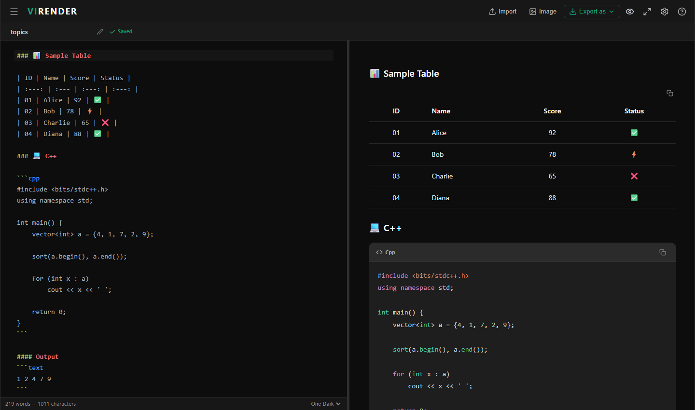

# Vrender

A split-pane Markdown editor with live rendering, math, and PDF export.

**Tech stack** · React · Vite · CodeMirror · Marked · KaTeX · pdfmake



## Edit, preview, export

Vrender is a browser-based Markdown workspace with a side-by-side editor and rendered preview. It supports syntax highlighting, KaTeX math, local document storage, theme settings, and PDF export.

| Part | Where to look |
| --- | --- |
| Markdown workspace | [Editor](src/components/Editor.jsx) and [preview](src/components/Preview.jsx) |
| PDF pipeline | [Export utilities](src/utils/exporter.js) |
| State and document controls | [App](src/App.jsx) and [workspace styles](src/styles/vrender.css) |

## Quick start

```bash
npm ci
npm run dev
```

Open the URL Vite prints. The sample document demonstrates formatting and preview behavior. Documents and preferences are stored in the browser's local storage.

## Tests and verification

```bash
npm run lint
npm run build
npm run preview
```

Open the preview, edit the sample, reload to test persistence, and export a PDF with a math expression and a code block.
